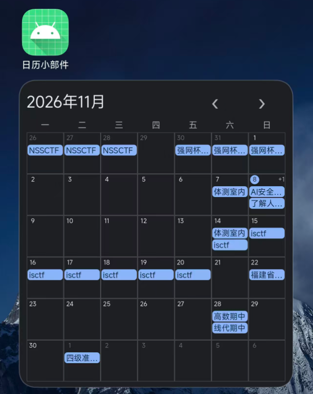
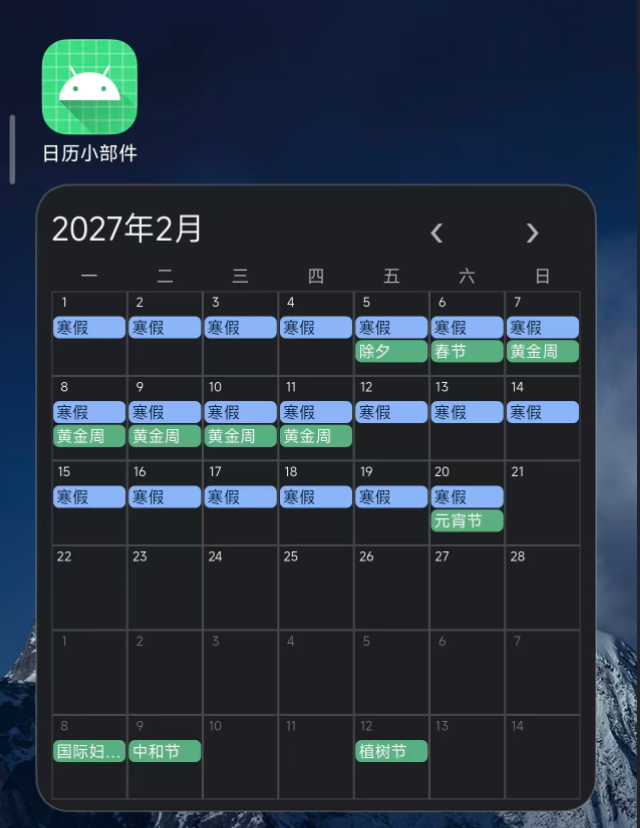
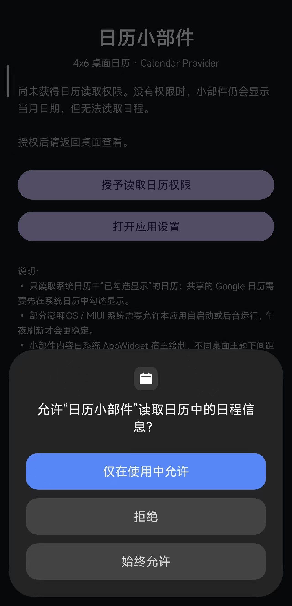
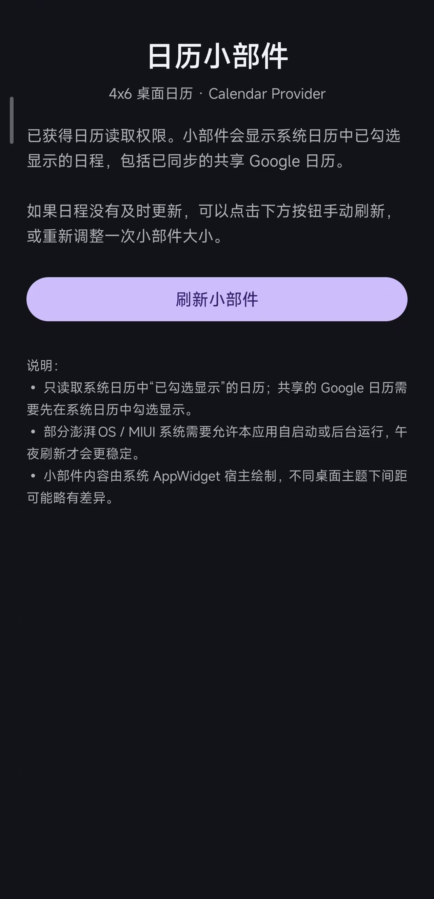

# 谷歌（Google）日历（Calendar）小部件（Widget）

## 写在前面

本人作为健忘症不知患没患者，一直记不住哪天要干哪些事，于是看到了谷歌日历的小部件能直观的展示，很是欣慰

可我的红米更新澎湃OS4以后，突然间原来使用的小部件死了，尝试了更新桌面程序，卸载重装，重启，可死活不行

实在没找，自己动手（吆喝大肥鱼），丰衣足食（我就爽歪歪）

> 此项目的全部代码都由大肥鱼买单，我不写代码，我只是大肥鱼的搬运工

## 功能

软件读取谷歌日历的数据，判断是否为节假日，展示到桌面小部件上

点击右上角左右箭头可以实现翻页，翻到你想去的那个月

点击这7*6的大小的面积，可以跳转到谷歌日历对应的月份

小部件最小4*4大小

---

效果如图

展示每天的活动

节日绿色，活动蓝色

---

## 使用教程

安装软件后打开，授权读取日历信息

> 强烈建议手动开启自启动选项，否则小部件可能不会正常刷新

---

随后点击刷新小部件

之后在桌面上添加小部件，即可使用

---
